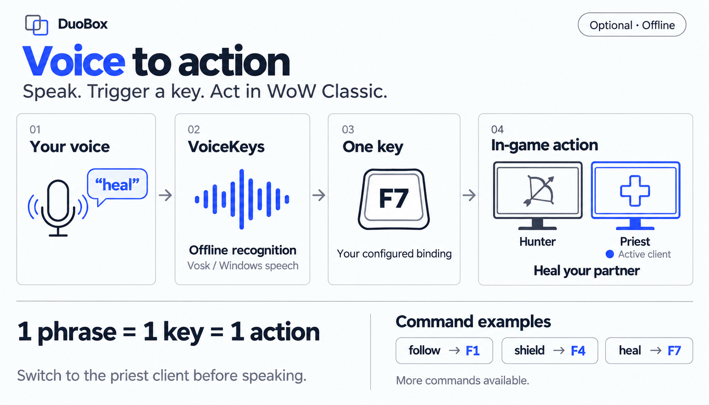

# DuoBox



World of Warcraft Classic addon for duo-boxing a healer (priest) and a DPS (hunter or warrior) on two clients,
without any key broadcasting: **1 key press = 1 action in 1 client**.

**Voice to action:** say **“heal”** → offline **VoiceKeys** recognition → **F7** → heal your partner.
Bind F7 to Heal with `/duo keys`, then speak while the priest's WoW client is focused.
VoiceKeys is optional: **1 phrase = 1 key**, sent to the active client on the same PC.
The diagram shows a few examples; see the [VoiceKeys setup and full command list](GUIDE.md#6-voicekeys-voice-commands-optional) for more.

- Cross-client alerts (low health, aggro, OOM, follow lost, quest item not looted) with sound and taskbar flash
- Priest cast bar and facing hints on the hunter's screen
- Warrior light (in range / facing / attacking) and event light (Overpower, Revenge, Execute... lit on the warrior) on the priest's screen
- Optional facing cone (`/duo cone on`, off by default): a yellow cone under the partner's nameplate shows where the partner faces. Open world only (Blizzard locks friendly nameplates in dungeons); the angle assumes your camera is behind your character
- Auto-accept invites, quests and resurrections from the partner; quest sharing and comparison
- RestedXP: each objective also shows the partner's progress, and the guide waits until both are done
- Options panel (`/duo` or the minimap button): every setting and action without typing commands
- Configuration profiles (`/duo profile`): save the settings under a name and load them on any character of the account
- Experimental partner minimap gathering detections: confirms native tooltips at known GatherLite locations, then shares recent mineral/herb sightings (`/duo tracking on` on both characters)
- Button bar with key bindings (`/duo keys`) and class macros (`/duo macros`)
- **Rotation** button (every class, one list per class): one key casts the first usable spell of a list you edit in game (`/duo rotation`)
- Optional **VoiceKeys**: offline voice commands (Vosk or Windows speech), one phrase = one key
- Optional hunter combat-exit notifications (feature flag disabled by default)
- Optional combat journal (`/duo journal on`, off by default) and `tools/analyze_fights.py`: measures the warrior's dead time in hard fights from the journal and the game's combat log
- Optional external **DuoRelay** (two PCs on one local network, off until switched on): a Ctrl+click on PC 1 presses the warrior's keys on PC 2. This is input broadcasting, which Blizzard forbids: use at your own risk ([GUIDE section 7](GUIDE.md#7-duorelay-ctrlclick-relayed-to-pc-2-optional-not-allowed-by-blizzard))
- With DuoRelay, an optional **warrior spell panel** on the priest's screen (`/duo panneau`, off by default): a click on a spell icon makes PC 2 press that spell's action-bar key, so the warrior casts it ([GUIDE section 7](GUIDE.md#warrior-spell-panel-click-an-icon-on-pc-1))
- With DuoRelay, optional **warrior camera and moves** from PC 1 (tab DuoRelay on the priest, off by default): Ctrl+Z held + the mouse turns the warrior's camera, Ctrl+Q / Ctrl+D / Ctrl+S held make it strafe or back up. The priest's game never gets these keys ([GUIDE section 7](GUIDE.md#warrior-camera-and-moves-from-pc-1-keys-the-priest-never-gets))

## Install
Copy the `DuoBox` folder into `World of Warcraft\_forever_\Interface\AddOns\` (or `_classic_era_\Interface\AddOns\`) on both clients, then in game:
```
/duo partner <OtherCharacterName>
```
Type `/duo` (or click the minimap button) to open the options panel, `/duo help` for all commands. Full documentation: [GUIDE.md](GUIDE.md).
